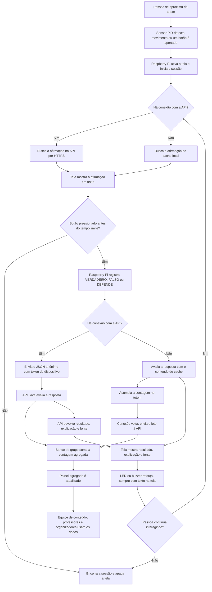

# Fluxograma: do dado à ação

O diagrama mostra o caminho dos dados desde a coleta, no sensor e nos botões, até o resultado na tela e a atualização do painel.



## Como ler

| Etapa | Blocos | O que acontece |
|---|---|---|
| Coleta | A a C, H, J | O sensor percebe a presença e os botões captam a resposta. A presença não sai do totem |
| Conteúdo | D a G | A afirmação vem da API ou, sem conexão, do cache |
| Comunicação | K, L, Q | O totem envia o JSON anônimo e recebe o retorno da API |
| Modo offline | R a T | O totem avalia pelo cache e envia as contagens quando a conexão volta |
| Processamento e destino | M a P | A API avalia, o banco soma a contagem e o painel mostra os totais |
| Ação | U, V | O participante vê o resultado e a explicação, com a fonte |
| Encerramento | W, I | Sem nova interação, a sessão termina |

Se ninguém apertar um botão ou continuar interagindo, a sessão termina e a tela apaga. Assim, a pessoa seguinte não vê o que a anterior estava fazendo.

## Exemplo de mensagem do bloco L

```json
{"tema":"radiacao","afirmacaoId":3,"resposta":"DEPENDE"}
```
